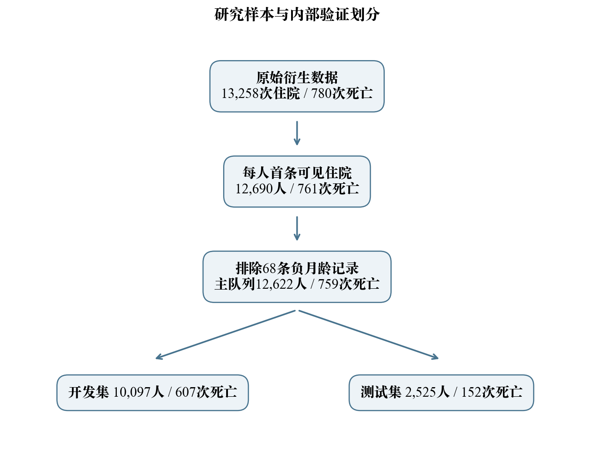
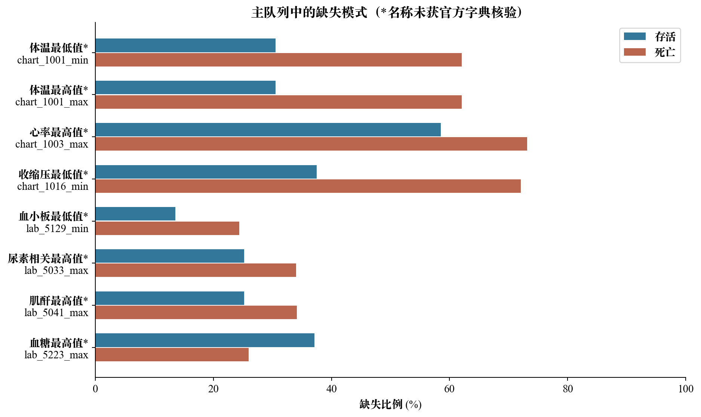
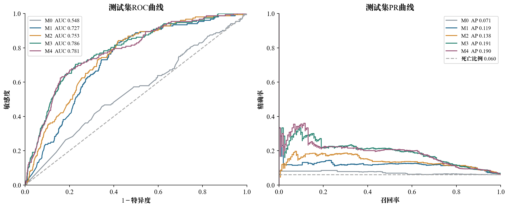
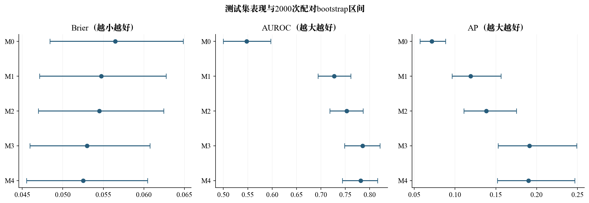
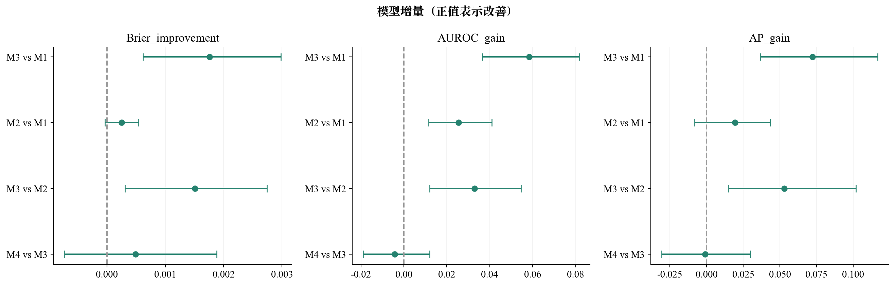
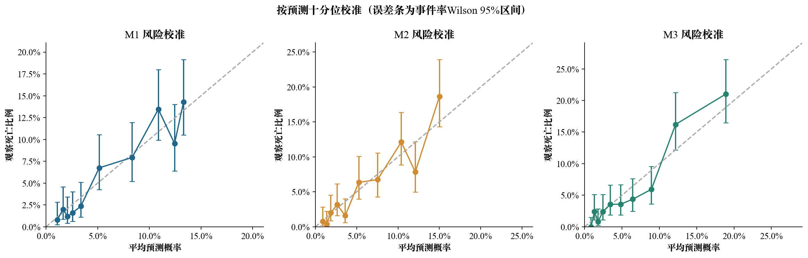
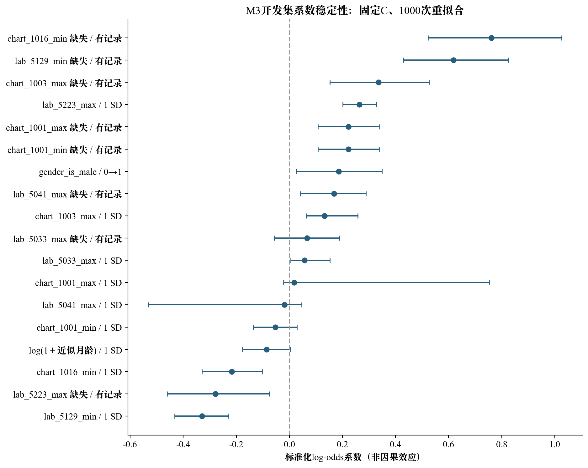
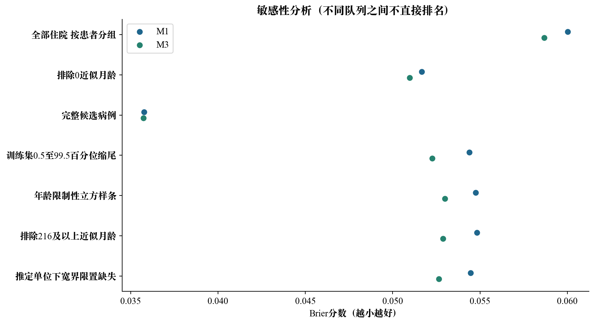

# 常规检验候选指标对PIC衍生样本院内死亡预测的增量价值

研究分析与图表结果　2026年11月9日

## 1 核心结果

扩展模型M3相对基础模型M1的Brier改善为0.00176，95%区间[0.00062, 0.00298]，区间完全高于0，支持在当前测试样本中存在改善。加入检验缺失标记的M2相对M1改善0.00025；在M2基础上加入检验数值，M3进一步改善0.00151，区间完全高于0，支持在当前测试样本中存在改善。

本次计算基于每人首条可见住院、排除负月龄后的12,622名患者，共759次院内死亡。开发集10,097人、死亡607人；测试集2,525人、死亡152人。结论限于既有PIC衍生样本的内部留出验证，不代表外部验证或临床可用性。

## 2 研究问题与实际执行

研究比较人口学、基础生命体征、检验可用性和检验数值的递进信息价值，结局为HOSPITAL_EXPIRE_FLAG，而非ICU死亡或固定天数死亡。采用预先指定的10个字段，不调用原importance_scores.csv选特征，不沿用原notebook性能。原输入SHA256为 `c0c27036909fcd017894fee3150cb99a5b0d6de20c82f51d4e95ef4e15379469`。

候选临床名称由现有代码注释提供，尚未取得同版本字典与单位证据。尤其lab_5033不能在尿素与尿素氮之间作未经证实的选择。所有图表以字段编号作为可追溯标识，带星号名称仅用于理解。主分析使用原数值，不按推定临床单位自动改动小数点或删除极端值。推定单位宽范围筛查和纯数值缩尾仅作为敏感性分析。未报告临床单位OR，也不把模型系数解释为治疗或病因效应。

按SUBJECT_ID保留ADMITTIME最早的现有记录，采用80/20结局分层随机切分，random_state=20261109，训练测试患者不重叠。每个训练折独立拟合中位数插补、连续项标准化和缺失标记。各模型共用开发集5折分层验证，以log-loss选择超参数，测试集未用于改变量或调参。样本已经用于前阶段质量核查，因此准确称为内部留出验证。

M0为年龄log1p及性别；M1增加4个生命体征数值及缺失标记；M2增加4个检验缺失标记；M3再增加4个检验数值；M4使用M3的信息及梯度提升。Logistic均不采用类别平衡权重、SMOTE或其他改变发生率的抽样。模型超参数如下：

| 模型 | 开发集选定超参数 |
| --- | --- |
| M0 | {"model__C": 1.0} |
| M1 | {"model__C": 1.0} |
| M2 | {"model__C": 10.0} |
| M3 | {"model__C": 0.1} |
| M4 | {"model__learning_rate": 0.1, "model__max_depth": 2} |

图1　研究样本与划分。首条记录仅指当前文件中可见首条，并非终生首次住院；排除早期死亡是原提取的选择，当前没有原始时间表重新确认严格24小时landmark。

## 3 描述性统计与缺失情况

| 字段 | 暂定名称 | 存活组 中位数[IQR]或n/N | 死亡组 中位数[IQR]或n/N | 缺失 存活/死亡 | BH校正P值 |
| --- | --- | --- | --- | --- | --- |
| age_month | 近似月龄 | 9.00 [1.00, 43.00] | 5.00 [0.00, 31.00] | 0/0 | 0.000192 |
| chart_1001_min | 体温最低值* | 36.50 [36.20, 36.80] | 36.40 [36.00, 36.80] | 3619/471 | 0.00146 |
| chart_1001_max | 体温最高值* | 37.00 [36.70, 37.30] | 37.00 [36.60, 37.50] | 3619/471 | 0.318 |
| chart_1003_max | 心率最高值* | 132.00 [120.00, 148.00] | 147.00 [130.00, 162.00] | 6939/555 | 5.58e-15 |
| chart_1016_min | 收缩压最低值* | 94.00 [80.00, 105.00] | 78.00 [63.00, 95.00] | 4446/547 | 9.34e-18 |
| lab_5129_min | 血小板最低值* | 290.00 [210.00, 376.00] | 191.00 [84.00, 302.00] | 1610/185 | 1.57e-44 |
| lab_5033_max | 尿素相关最高值* | 3.90 [2.80, 5.16] | 4.62 [3.22, 6.96] | 2993/258 | 8.46e-16 |
| lab_5041_max | 肌酐最高值* | 49.00 [41.00, 66.20] | 62.00 [43.00, 88.22] | 2987/259 | 3.39e-14 |
| lab_5223_max | 血糖最高值* | 6.20 [5.20, 8.40] | 8.00 [5.80, 11.78] | 4400/197 | 5.26e-28 |
| gender_is_male | 男性标记 | 6739/11863 (56.8%) | 480/759 (63.2%) | 0/0 | 0.000643 |

连续变量统计与Mann–Whitney检验仅使用各组非缺失值；性别用卡方检验；10项P值作BH校正。P值不用于变量选择。缺失标记的作用可能反映检查流程、病情或记录完整性，不能据此推断未记录检查本身导致死亡。

从已记录的数值看，死亡组lab_5129_min中位数为191，存活组为290；lab_5223_max分别为8.00和6.20，lab_5041_max分别为62和49。它们的方向与部分临床预期相符，但目前只能按字段报告，不能以此替代单位核验。死亡组生命体征记录更稀疏，而lab_5223_max的缺失更少，说明记录机制并非简单统一的“病重所以检查更多”。

图2　主队列候选变量缺失比例。与前阶段全部住院记录的缺失图统计范围不同。

## 4 测试集预测表现

| 模型 | Brier及95%区间 | AUROC及95%区间 | AP及95%区间 | Brier skill |
| --- | --- | --- | --- | --- |
| M0 | 0.0565 [0.0484, 0.0649] | 0.548 [0.500, 0.597] | 0.071 [0.057, 0.088] | 0.002 |
| M1 | 0.0548 [0.0471, 0.0627] | 0.727 [0.694, 0.761] | 0.119 [0.096, 0.156] | 0.032 |
| M2 | 0.0545 [0.0470, 0.0624] | 0.753 [0.718, 0.787] | 0.138 [0.111, 0.175] | 0.037 |
| M3 | 0.0530 [0.0459, 0.0608] | 0.786 [0.749, 0.821] | 0.191 [0.153, 0.249] | 0.063 |
| M4 | 0.0525 [0.0455, 0.0604] | 0.781 [0.744, 0.816] | 0.190 [0.152, 0.247] | 0.072 |

测试发生率为0.0602，仅用开发集发生率预测的空模型Brier为0.05657。Brier skill以这一空模型为参照。AP使用average_precision_score而非梯形积分PR-AUC。区间来自同一测试患者索引的2000次配对bootstrap，表示固定模型的测试评价不确定性，不覆盖完整开发流程的不确定性。

图3　同一测试集ROC与PR曲线；PR横线是测试发生率，不是模型输出的平均风险。

图4　指标与bootstrap区间。Brier越低越好，AUROC和AP越高越好；不同量纲指标不横向比较数值大小。

## 5 检验数值与缺失标记的增量

| 比较 | 指标 正值为改善 | 估计 | 95%区间 |
| --- | --- | --- | --- |
| M3 vs M1 | Brier_improvement | 0.00176 | [0.00062, 0.00298] |
| M3 vs M1 | AUROC_gain | 0.05840 | [0.03658, 0.08173] |
| M3 vs M1 | AP_gain | 0.07229 | [0.03688, 0.11680] |
| M2 vs M1 | Brier_improvement | 0.00025 | [-0.00003, 0.00055] |
| M2 vs M1 | AUROC_gain | 0.02551 | [0.01161, 0.04102] |
| M2 vs M1 | AP_gain | 0.01933 | [-0.00818, 0.04355] |
| M3 vs M2 | Brier_improvement | 0.00151 | [0.00031, 0.00274] |
| M3 vs M2 | AUROC_gain | 0.03289 | [0.01197, 0.05455] |
| M3 vs M2 | AP_gain | 0.05296 | [0.01499, 0.10194] |
| M4 vs M3 | Brier_improvement | 0.00049 | [-0.00072, 0.00188] |
| M4 vs M3 | AUROC_gain | -0.00418 | [-0.01895, 0.01196] |
| M4 vs M3 | AP_gain | -0.00111 | [-0.03066, 0.02974] |

扩展模型M3相对基础模型M1的Brier改善为0.00176，95%区间[0.00062, 0.00298]，区间完全高于0，支持在当前测试样本中存在改善。加入检验缺失标记的M2相对M1改善0.00025；在M2基础上加入检验数值，M3进一步改善0.00151，区间完全高于0，支持在当前测试样本中存在改善。

M3相对M2的差值表示“在已有检验缺失标记后的数值预测增量”，并不是检验的因果贡献或信息占比。M4为补充算法，不能因为其表现优于其他模型就替代预先指定的主要比较。

具体而言，M2相对M1的AUROC增益区间高于0，但Brier改善区间跨0；加入检验数值后，M3相对M2的Brier、AUROC和AP增益区间均高于0，因此当前结果不支持将全部改善归于缺失标记。M4相对M3的三项增益区间均包含0，没有足够证据认定梯度提升优于扩展Logistic模型。

图5　相同测试患者配对比较所得增量区间。只比较两个单独区间是否重叠不能替代这里的配对差值分析。

## 6 风险校准与阈值表现

| 模型 | 平均预测风险 | 观察发生率 | 校准截距 CITL | 联合校准斜率 |
| --- | --- | --- | --- | --- |
| M0 | 0.0601 | 0.0602 | 0.002 | 0.867 |
| M1 | 0.0607 | 0.0602 | -0.009 | 0.932 |
| M2 | 0.0604 | 0.0602 | -0.003 | 0.959 |
| M3 | 0.0611 | 0.0602 | -0.016 | 1.047 |
| M4 | 0.0610 | 0.0602 | -0.015 | 1.079 |

校准截距以logit(p)为offset估计，理想值0；校准斜率与截距共同估计，理想斜率1。对计算使用的概率截于[1e-6,1-1e-6]。这些是点估计，未给校准参数置信区间；仅凭数值接近理想值不能宣布完全校准。校准图误差条是各十分位组观察事件率的Wilson区间，不是个体风险区间。

图6　预设M1至M3的校准图。最高风险组受样本及事件数限制，应结合tables/11_calibration_bins.csv审阅。

| 模型 | 开发集OOF阈值 | 测试敏感度 | 特异度 | PPV | NPV |
| --- | --- | --- | --- | --- | --- |
| M0 | 0.0525 | 0.796 | 0.258 | 0.064 | 0.952 |
| M1 | 0.0481 | 0.842 | 0.563 | 0.110 | 0.982 |
| M2 | 0.0519 | 0.842 | 0.573 | 0.112 | 0.983 |
| M3 | 0.0491 | 0.816 | 0.580 | 0.111 | 0.980 |
| M4 | 0.0489 | 0.796 | 0.600 | 0.113 | 0.979 |

阈值是在开发集OOF预测中满足敏感度>=80%的最高阈值，随后固定应用至测试集。测试敏感度不保证仍达到80%。该阈值仅用于演示分类权衡，不是临床分诊建议。

在M3中，阈值约0.0491时，测试集152例死亡识别124例，同时出现997例假阳性，PPV约11.1%。这说明区分度的统计改善并不自动形成高精确度的分诊工具；在未界定干预行动、资源成本及误报代价前，不能建议按这一阈值临床执行。

## 7 系数稳定性

图7　M3固定已选C后，在开发集1000次患者bootstrap中重拟合插补、缩放及模型。连续项换算为同一主开发集1个标准差的log-odds系数；二分类项为0到1。年龄为log(1+近似月龄)，不是每增加1月。区间是条件于既定模型结构和C的稳定性区间，不包括变量语义不确定性及调参选择不确定性。体温最低值和最高值的缺失标记可能完全同源，个别系数不宜独立作生理解释。此图不替代临床单位OR分析。

## 8 敏感性分析

| 情景 | 模型 | 样本/死亡 | 测试样本/死亡 | Brier | AUROC | AP |
| --- | --- | --- | --- | --- | --- | --- |
| 全部住院 按患者分组 | M1 | 13190/778 | 2625/174 | 0.06003 | 0.710 | 0.122 |
| 全部住院 按患者分组 | M3 | 13190/778 | 2625/174 | 0.05867 | 0.764 | 0.182 |
| 排除0近似月龄 | M1 | 9728/556 | 1946/111 | 0.05167 | 0.732 | 0.115 |
| 排除0近似月龄 | M3 | 9728/556 | 1946/111 | 0.05098 | 0.774 | 0.170 |
| 完整候选病例 | M1 | 1768/64 | 354/13 | 0.03576 | 0.523 | 0.071 |
| 完整候选病例 | M3 | 1768/64 | 354/13 | 0.03573 | 0.598 | 0.095 |
| 训练集0.5至99.5百分位缩尾 | M1 | 12622/759 | 2525/152 | 0.05438 | 0.727 | 0.119 |
| 训练集0.5至99.5百分位缩尾 | M3 | 12622/759 | 2525/152 | 0.05227 | 0.785 | 0.205 |
| 年龄限制性立方样条 | M1 | 12622/759 | 2525/152 | 0.05474 | 0.729 | 0.120 |
| 年龄限制性立方样条 | M3 | 12622/759 | 2525/152 | 0.05299 | 0.786 | 0.191 |
| 排除216及以上近似月龄 | M1 | 12620/759 | 2524/152 | 0.05482 | 0.725 | 0.116 |
| 排除216及以上近似月龄 | M3 | 12620/759 | 2524/152 | 0.05289 | 0.786 | 0.197 |
| 推定单位下宽界限置缺失 | M1 | 12622/759 | 2525/152 | 0.05445 | 0.727 | 0.119 |
| 推定单位下宽界限置缺失 | M3 | 12622/759 | 2525/152 | 0.05264 | 0.786 | 0.195 |

图8　敏感性分析固定使用主分析已选C，比较同一情景下M1与M3；不同情景的发生率、样本及划分不同，不能用原始Brier作跨人群优劣排名。完整病例丢失大量样本且事件数较少，属于选择性人群。非0月龄不等于精确日龄定义的非新生儿。宽界限清洗依赖代码推定单位；缩尾仅为数值稳健性检查，不声称确定了单位或极端值真伪。

各预设情景中M3的Brier点估计均低于对应M1；缩尾及宽界限情景下增量方向没有反转。不过，敏感性分析未另给bootstrap区间，不能把方向一致写成所有情景均有统计证据。完整病例仅1768人、64例死亡，其中测试集13例死亡，M3 AUROC降至约0.598；这种明显差异提示样本选择和事件稀少的影响，不能当作与主队列等价的独立验证。

## 9 解释边界与可得结论

本研究可以回答预设编号特征在当前衍生数据中的增量预测表现，不能证明这些检验具有因果作用。仍有三个主要限制：第一，提取代码医院入院窗口缺少非负下界，无法用当前汇总数据修复；第二，原提取仅排除24小时内死亡者而未确认所有患者在24小时仍在院，预测时点不严格；第三，候选变量名称、标本及单位未完成官方核验。

这些限制意味着即使有统计改善，也只支持继续核验数据与外部验证，不支持真实床旁使用。未计算DCA，因为尚未定义可执行干预及其效用权衡；未计算生存曲线或生存模型，因为无可靠随访时长。负月龄排除、重复患者处理、原值主分析及敏感性假设均已在计算前记录。

相对M1的Brier降低约3.21%，M3相对仅预测开发集发生率的空模型Brier改善约6.33%，均属于预测误差的相对改善，不是死亡率降低或可避免死亡的比例。本次最稳妥的结论是：在当前衍生数据的内部留出样本中，预设4项检验编号数值提供了超过缺失模式的额外预测信息；其临床解释和实际使用仍需数据语义、时间窗口及外部数据验证。

## 10 复现与文件

运行code/analyze_pic.py可从原CSV重新计算表格和图；运行code/build_results_report.py重建本报告。图表提供PNG、矢量PDF及SVG。tables为汇总统计，private仅保留本地划分与测试预测，不进入分享压缩包。运行环境及种子见run_summary.json；运行耗时约43秒，不含报告整理与人工核查。

本文件为分析阶段结果报告，可离线查看；未声称为LaTeX编译的课程终稿。下一步若整合课程提交，应在此基础上编制LaTeX正文与展示网页，并保持上述结果与适用范围一致。

## 11 研究来源

1. PIC官方说明：https://physionet.org/content/picdb/1.1.0/ 。不据此推定当前CSV的版本。
2. Zeng X, et al. PIC, a paediatric-specific intensive care database. Scientific Data. 2020;7:14. https://doi.org/10.1038/s41597-020-0355-4
3. Hong S, et al. Predicting Risk of Mortality in Pediatric ICU Based on Ensemble Step-Wise Feature Selection. Health Data Science. 2021:9365125. https://doi.org/10.34133/2021/9365125 。现有代码来源相关研究，本轮未借用其性能结果。
4. 本轮基于本地数据实际计算的统计结果见表格与运行摘要；未进行新的文献系统综述。
